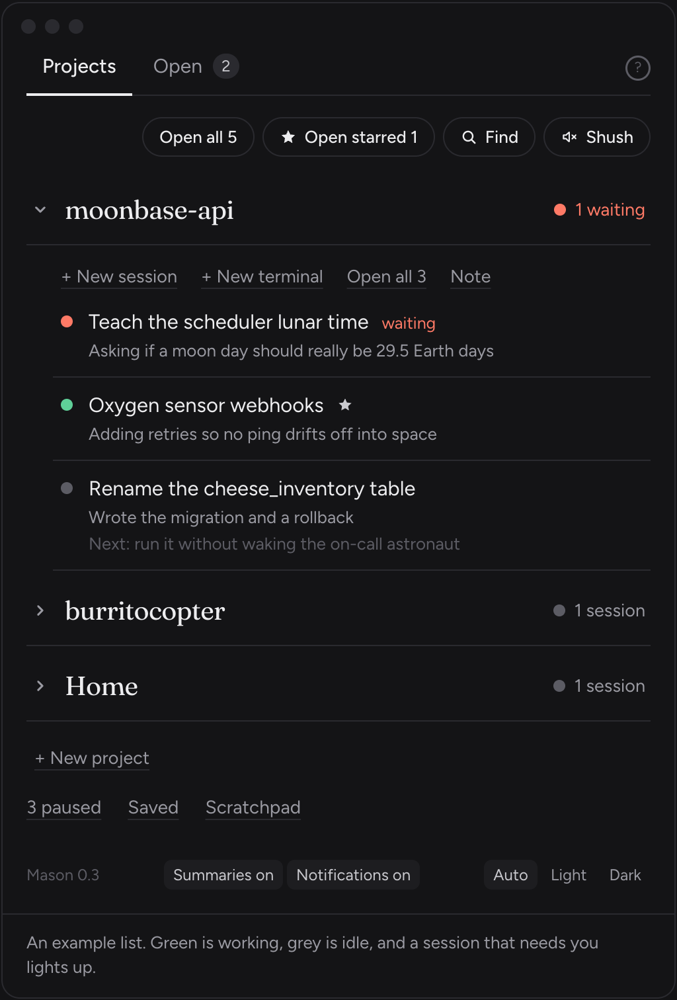

<p align="center">
  
</p>

<h1 align="center">Mason</h1>

<p align="center"><b>A home for all your Claude Code sessions</b><br>
What each one is doing, what's waiting on you, and where you left off.</p>

<p align="center"><a href="https://mason-builds.vercel.app">Website</a> · <a href="#install">Install</a> · <a href="ROADMAP.md">Roadmap</a></p>

<p align="center">
  
</p>

- **Every session in one list**, grouped by project, with a dot for working, quiet, or waiting on you
- **Sessions live inside Mason** and keep running when you close the window or quit
- **Remember where you were**: a two-line recap per session, `/pause` handoffs, and notes that stick
- **Catch a thought fast** with <kbd>⌃⌥N</kbd> from any app, or `/stash` inside Claude

A local macOS desktop app (Electron). It has no network port and nothing leaves your Mac except the short summaries it asks Claude to write, which you can turn off.

## Install

You need a Mac with Apple silicon, [Claude Code](https://docs.claude.com/en/docs/claude-code), [Homebrew](https://brew.sh), and Node.js 20 or newer.

```sh
git clone https://github.com/brittanyrferrero/mason.git ~/mason && cd ~/mason
brew install tmux && npm install
node scripts/hooks.mjs install   # "waiting on you", /pause and /stash (backs up your settings first)
scripts/install-app.sh           # builds Mason.app into ~/Applications and opens it
```

Then press <kbd>⌃⌥M</kbd> from anywhere to bring Mason forward, and <kbd>?</kbd> inside it for the help card.
To update, pull and run `scripts/install-app.sh` again; running sessions keep going.

## Working on Mason

```sh
npm install      # once (also needs: brew install tmux)
scripts/install-app.sh   # build Mason.app, quit the running one (sessions keep going), swap it in, reopen
npm run dist     # just build Mason.app into dist/mac-arm64/
npm start        # run from source without packaging
npm run dev      # hot-reloading dev mode while working on the UI
```

## How sessions work

Sessions you start or resume in Mason run inside a private, invisible tmux server (`tmux -L mason`).
Closing a window in the Open tab, or quitting Mason, only detaches; Claude keeps running and Mason
reattaches next time. Escape hatch from any Terminal: `tmux -L mason ls`, then `tmux -L mason attach -t ms-xxxxxxxx`.

Sessions started in a normal Terminal still show up (marked "in Terminal"). Clicking one brings its Terminal
window forward; "Move here" stops it there and resumes the same conversation inside Mason.

## "Waiting on you"

`node scripts/hooks.mjs install` adds Claude Code hooks to `~/.claude/settings.json` (backup in `~/.mason/backups/`). It also adds two commands to `~/.claude/commands`: `/pause` (Claude writes a handoff note; Mason files it on the paused list and stops the session) and `/stash` (the hook files Claude's last reply, or `idea …` / `later …`, into Saved and blocks the prompt, so it costs no turn).
They run `~/.mason/hook.sh`, which appends one short line per event to `~/.mason/events.jsonl` — no network.
Permission prompts and AskUserQuestion turn a session coral, sort it first, and badge the Dock.
`node scripts/hooks.mjs uninstall` removes exactly those entries.

## Where things live

- `src/main/` — the privileged side: reads `~/.claude/projects/**/*.jsonl` (transcripts) and `~/.claude/sessions/*.json` (which sessions are running, busy or idle), and keeps Mason's own data in `~/.mason/mason.db`.
- `src/preload/` — the tiny, fixed bridge the window is allowed to use.
- `src/renderer/` — the Quiet list UI (React).

Sessions are grouped by the folder they started in; git worktrees roll up into one project. A session started in `~` follows the project folder it spent the most time in. Hover a project's name and click the T to rename it (empty goes back to the folder name). Automated runs (`claude -p`, SDK) are hidden.

## Developer checks

```sh
npx electron-vite build
./node_modules/.bin/electron . --dump-state                 # print what Mason sees, then exit
./node_modules/.bin/electron . --snapshot=out.png --theme=dark  # render off-screen to a PNG
```

## Status

See [ROADMAP.md](ROADMAP.md) for what's done and what's next.

### Signing (so macOS remembers permissions)

`npm run dist` signs the app with a self-signed **Mason Local** certificate from your login keychain
(`scripts/sign.mjs`). A stable signature makes macOS treat every rebuild as the same app, so permissions you grant
(folders, Photos, controlling Terminal) stick instead of being asked again after each build. Without the
certificate, the build still works but keeps a throwaway signature.
